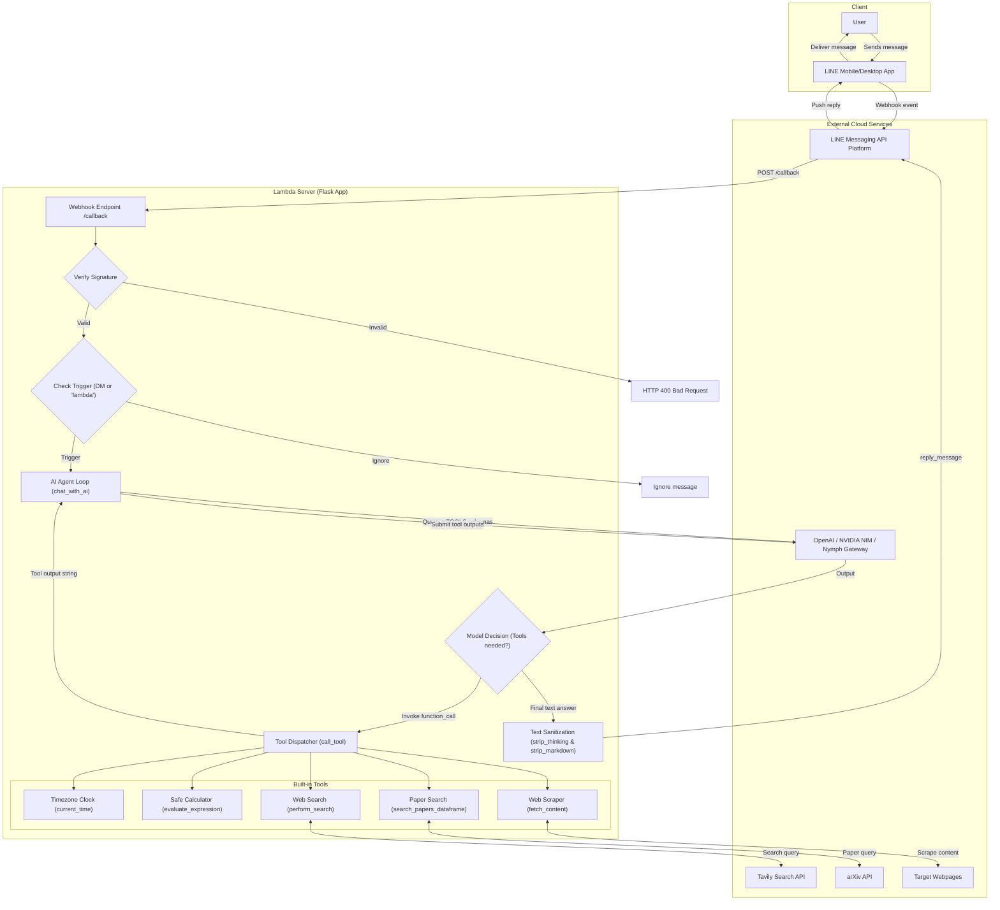
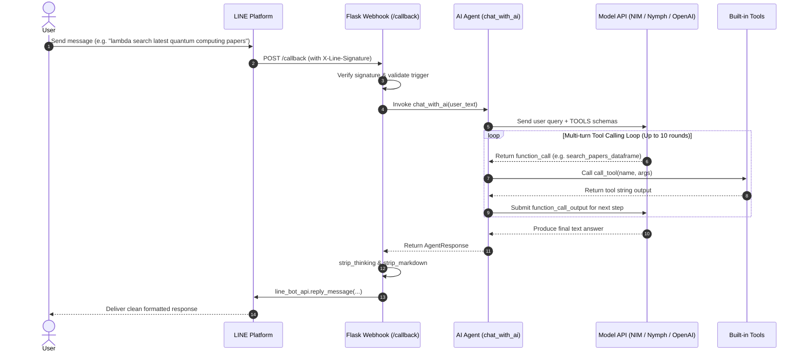

# lambda

[正體中文](README.zh-TW.md) | English

[Join our LINE OpenChat ✨](https://web-tech.tw/ai)

> A friendly, autonomous tool-calling LINE chatbot agent designed for beginners and developers alike.

---

## Project Status: Feature-Frozen

> [!NOTE]
> **This project (lambda) serves as a concise, beginner-friendly starter and reference template for learning LLM Agents, Tool Calling, and LINE Messaging API integration. Its feature set is now complete and declared Feature-Frozen.**
>
> To preserve its lightweight, clean, and easily readable codebase, no additional features will be added to this bot. If you are interested in exploring larger-scale AI gateways, inference infrastructure, or protocol translation, we invite you to collaborate on the **[Nymph](https://github.com/web-tech-tw)** ecosystem!

---

## Overview

**lambda** is an intelligent LINE bot built with Python, Flask, and OpenAI's API (supporting both Responses API and Function Calling).

This project serves as an accessible, beginner-friendly starter for learning **LLM Agents**, **Tool Calling**, and **LINE Messaging API integration**. Unlike traditional chatbots limited to static knowledge, lambda is equipped with an autonomous agent loop that can decide, execute external tools, and synthesize answers:
- When real-time information is requested, it searches the web.
- When arithmetic or calculations are needed, it uses a safe AST math engine rather than hallucinating numbers.
- When research papers are asked for, it queries the arXiv academic database.
- It parses external webpages, extracts clean text, strips internal reasoning tokens (`<think>`), and converts Markdown to readable plain text formatted specifically for LINE.

---

## Features

- 🤖 **Autonomous Agent Loop**: Multi-turn tool execution loop with support for both native function calls and text-advised fallback.
- ⚡ **Multi-Provider Support (including NVIDIA NIM & Nymph)**: Seamlessly connects with high-performance NVIDIA NIM microservices, the Nymph community free gateway, or the official OpenAI API.
- 🔍 **Real-Time Web Search**: Powered by the [Tavily Search API](https://tavily.com/) for up-to-date web results.
- 📚 **Academic Paper Search**: Queries [arXiv](https://arxiv.org/) for papers by title, abstract, author, or category.
- 🌐 **Web Scraping & Extraction**: Extracts readable text from URLs using Scrapy & Requests, with depth crawling and regex pattern filtering.
- 🧮 **Safe Math Calculator**: Evaluates arithmetic expressions safely using Python's Abstract Syntax Tree (AST).
- 🕒 **World Clock**: Looks up current timestamps across any IANA timezone.
- 🧹 **LINE Text Optimization**: Automatically strips `<think>...</think>` internal model thoughts and converts Markdown into clean, uncluttered plain text.
- 👥 **Dual Conversation Modes**:
  - **1-on-1 Direct Messages**: Directly chat with the bot.
  - **Group Chats**: Bot responds whenever a message starts with `lambda` (e.g., `lambda what is the latest AI news?`).

---

## Architecture & Workflow

### 1. System Architecture



### 2. Message & Tool-Calling Sequence Diagram



---

## Prerequisites

Before getting started, make sure you have the following installed on your system:

- **Python >= 3.14**: We recommend the latest stable Python release.
- [**uv**](https://docs.astral.sh/uv/): An extremely fast Python package and project manager. Install it via:
  ```bash
  # macOS / Linux
  curl -LsSf https://astral.sh/uv/install.sh | sh

  # Windows (PowerShell)
  powershell -ExecutionPolicy ByPass -c "irm https://astral.sh/uv/install.ps1 | iex"
  ```
- **LINE Messaging API Channel**: Create a channel at the [LINE Developers Console](https://developers.line.biz/) to get your credentials.
- **Model Provider Credentials (Choose one)**:
  1. **NVIDIA NIM** (Recommended for high-performance inference)
  2. **Nymph Community Free Gateway** (Best for zero-cost learners)
  3. **Official OpenAI API**
- **Tavily API Key**: Required for web searches (sign up for free at [Tavily](https://tavily.com/)).

---

## Environment Configuration

Copy the sample environment file `.env.sample` to `.env`:

```bash
cp .env.sample .env
```

Open `.env` in your editor and configure the following variables:

| Variable | Description | Example / Default | Required |
| --- | --- | --- | --- |
| `LINE_CHANNEL_ACCESS_TOKEN` | Long-lived channel access token from LINE Developers | From LINE Developers Console | **Yes** |
| `LINE_CHANNEL_SECRET` | Channel secret from LINE Developers | From LINE Developers Console | **Yes** |
| `OPENAI_BASE_URL` | Base URL for model provider (supports NIM, Nymph, OpenAI) | `https://api.openai.com/v1` | Optional |
| `OPENAI_API_KEY` | API Key for model provider | `sk-...` / `nvapi-...` / `nymph ...` | **Yes** |
| `OPENAI_CHAT_MODEL` | Chat model identifier | `gpt-3.5-turbo` / `openai/gpt-oss-20b` | Optional |
| `OPENAI_SYSTEM_PROMPT` | Custom system prompt override | `None` (uses built-in prompt) | Optional |
| `TAVILY_API_KEY` | API Key for Tavily Search | `tvly-...` | **Yes for search** |
| `AGENT_TIMEOUT_SECONDS` | Agent execution timeout in seconds | `60` | Optional |

### Model Provider Configurations

#### Option 1: NVIDIA NIM (High-Performance Inference Microservices)
```ini
OPENAI_BASE_URL="https://integrate.api.nvidia.com/v1"
OPENAI_API_KEY="nvapi-your-key-here"
OPENAI_CHAT_MODEL="openai/gpt-oss-20b"
```

#### Option 2: Nymph Community Gateway (Free for Learning & Testing)
```ini
OPENAI_BASE_URL="https://web-tech.tw/recv/openai/v1"
OPENAI_API_KEY="nymph zr3Pjc68z4bOtw=="
OPENAI_CHAT_MODEL="auto"
```

#### Option 3: Official OpenAI API
```ini
OPENAI_BASE_URL="https://api.openai.com/v1"
OPENAI_API_KEY="sk-your-openai-api-key"
OPENAI_CHAT_MODEL="gpt-3.5-turbo"
```

---

## Setup & Installation

Install dependencies and set up the virtual environment in one command using `uv`:

```bash
uv sync
```

---

## Running the Application

### 1. Development Mode

Start the Flask development server with auto-reload and debug mode enabled:

```bash
uv run flask run --debug --reload
```
By default, the server listens at `http://127.0.0.1:5000/`.

### 2. Production Mode

Run with the high-performance Gunicorn WSGI server:

```bash
uv run gunicorn -w 4 app:app
```

---

## LINE Webhook Configuration

1. Expose your server to HTTPS using a reverse proxy, Cloudflare Tunnel, or ngrok.
2. In the [LINE Developers Console](https://developers.line.biz/), select your Messaging API channel.
3. Under the **Messaging API** tab, set the **Webhook URL** to:
   ```text
   https://<your-domain>/callback
   ```
4. Enable the **Use webhook** toggle.
5. Click **Verify** to confirm the connection, and start chatting with your bot on LINE!

---

## Built-in Tools

lambda's built-in tools are organized in the `tools/` directory:

| Tool Name (`name`) | Location | Description |
| --- | --- | --- |
| `current_time` | [tools/clock.py](tools/clock.py) | Returns current date and time for a given IANA timezone (e.g., `Asia/Taipei`, `UTC`). |
| `evaluate_expression` | [tools/calculator.py](tools/calculator.py) | Safely evaluates arithmetic expressions using AST parsing to avoid code injection. |
| `perform_search` | [tools/search.py](tools/search.py) | Performs real-time web searches using Tavily API. |
| `search_papers_dataframe` | [tools/search.py](tools/search.py) | Queries arXiv for academic papers and formats summary metadata. |
| `fetch_content` | [tools/content.py](tools/content.py) | Fetches text from URLs with recursive depth traversal and regex pattern matching. |

---

## Project Structure

```text
lambda/
├── app.py              # Flask webhook endpoint and LINE event handler
├── config.py           # Centralized configuration and environment loading
├── prompts.py          # AI agent default system prompt and persona
├── clients/
│   ├── line.py         # LINE Bot SDK initialization
│   └── openai.py       # Async OpenAI client and agent multi-turn loop
├── tools/
│   ├── __init__.py     # Module exports
│   ├── tools.py        # Tool schema definitions, validation, and dispatcher
│   ├── calculator.py   # Safe AST arithmetic calculator
│   ├── clock.py        # Timezone clock lookup
│   ├── content.py      # Web scraper and text extractor
│   └── search.py       # Tavily web search and arXiv academic paper search
├── utils/
│   ├── __init__.py     # Utility package exports
│   ├── markdown.py     # Markdown-to-plain-text stripper for clean LINE messages
│   └── response.py     # Filter for internal reasoning blocks (<think>)
├── pyproject.toml      # Project metadata and dependencies (uv / PEP 621)
├── uv.lock             # Deterministic dependency lockfile
├── .env.sample         # Sample environment variable template
└── LICENSE             # MIT Open Source License
```

---

## 🤝 Co-maintaining & Supporting Nymph

**lambda** is built alongside the **[Nymph](https://github.com/web-tech-tw)** open-source initiative driven by the Taiwan Web Technology Promotion Organization (Web-Tech-TW / AI-Tech-TW).

### What is Nymph?
Nymph is a community-driven intelligent consultant service and model conversion infrastructure. To eliminate economic hurdles for students and indie developers, Nymph offers a free OpenAI-compatible gateway powered by cutting-edge inference microservices including **NVIDIA NIM**, enabling access to powerful open models without upfront costs.

### Join Us in Maintaining Nymph!
Because **lambda's feature set is now frozen**, all further backend expansion, provider routing, proxy conversions, and microservice infrastructure will continue to evolve in the Nymph ecosystem!

We warmly welcome developers to contribute and maintain Nymph together:
- 🌐 **[ai-tech-tw/ironnect](https://github.com/ai-tech-tw/ironnect)**: RESTful LLM gateway and protocol conversion service.
- 🛠️ **[web-tech-tw/nymph-stack](https://github.com/web-tech-tw/nymph-stack)**: Infrastructure as Code (IaC) deployment and containerized service stack.
- 🧪 **[Online Demo](https://ai.web-tech.tw/openai)**: Test Nymph model endpoints directly in your browser.
- 💬 **[Join LINE OpenChat ✨](https://web-tech.tw/ai)**: Chat with fellow developers, share feedback, and contribute.

---

## License

This project is open-source software licensed under the [MIT License](LICENSE).
