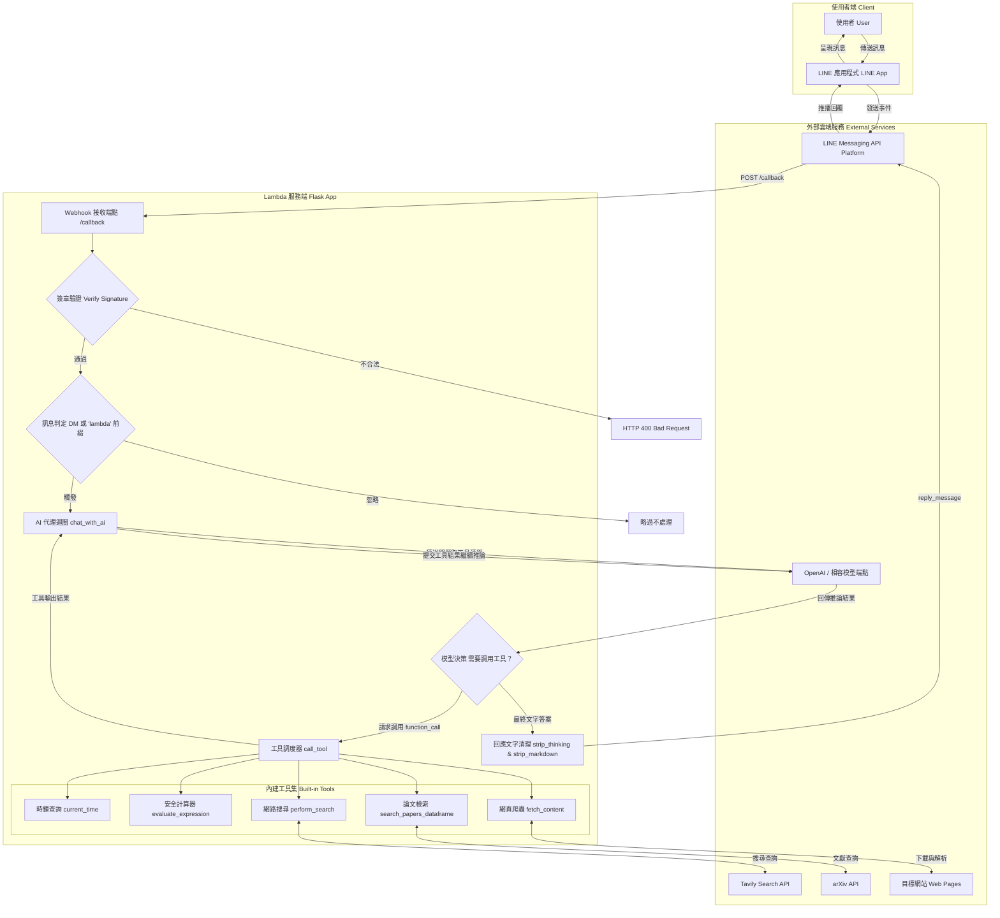
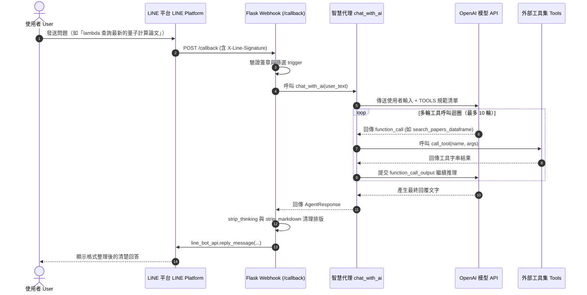

# lambda

正體中文 | [English](README.md)

[加入我們的 LINE 社群 ✨](https://web-tech.tw/ai)

> 一個專為初學者與新手設計、具備自主工具呼叫（Tool-Calling Agent）能力的 LINE 智慧助理機器人。

---

## 專案簡介

**lambda** 是一個基於 Python Flask 與 OpenAI API（支援 Responses API / Function Calling）構建的智慧 LINE Bot。

本專案旨在作為初學者學習 **LLM Agent（智慧代理）**、**函數調用（Tool Calling）** 與 **LINE Messaging API 整合** 的絕佳入門範例。不同於傳統只能依賴模型內部記憶回答的聊天機器人，lambda 擁有「自主思考與調用外部工具」的能力：
- 當使用者詢問即時資訊時，它會主動搜尋網路；
- 當使用者需要數學運算時，它會調用安全計算機而非胡亂臆測；
- 當使用者需要論文摘要時，它能向 arXiv 檢索學術文獻；
- 收到工具回傳結果後，它會自動彙整成有條理、親切易懂的回答，並過濾掉內部推理過程，將 Markdown 排版轉換成適合 LINE 閱讀的純文字格式。

---

## 主要特色

- 🤖 **自主 Agent 工具呼叫迴圈**：具備多輪工具調用決策機制，支援原生 Function Call 與文字退避（fallback）建議。
- 🔍 **即時網路搜尋**：串接 [Tavily Search API](https://tavily.com/)，隨時掌握時事與最新資訊。
- 📚 **學術論文檢索**：查詢 [arXiv](https://arxiv.org/) 文獻庫，支援標題、摘要、作者或分類搜尋並整理論文摘要。
- 🌐 **網頁內容爬取與解析**：利用 Scrapy 與 Requests 擷取指定網頁的可讀內文，支援深度爬取與正規表示式（Regex）篩選。
- 🧮 **安全數學運算器**：透過 Python AST 抽象語法樹進行純數學運算，防止任意程式碼執行風險。
- 🕒 **世界時區時鐘**：支援查詢全球各 IANA 時區之當前精確時間。
- 🧹 **針對 LINE 顯示優化**：自動過濾模型推理區塊（`<think>...</think>`），並將 Markdown 標記轉為清爽易讀的純文字排版。
- 👥 **雙重對話模式**：
  - **1 對 1 私聊**：直接傳送訊息即可對話。
  - **群組聊天**：只要訊息以 `lambda` 開頭（例如：`lambda 幫我查一下明天台北天氣`），機器人便會主動回應。

---

## 系統架構與運作流程（Architecture & Workflow）

### 1. 系統整體架構圖（System Architecture）



### 2. 訊息處理與多輪工具調用時序圖（Sequence Diagram）



---

## 系統需求（Prerequisites）

在開始之前，請確認您的電腦已安裝以下環境：

- **Python >= 3.14**：推薦使用最新穩定版本的 Python。
- [**uv**](https://docs.astral.sh/uv/)：現代化且極速的 Python 套件與環境管理工具。若尚未安裝，可透過以下指令安裝：
  ```bash
  # macOS / Linux
  curl -LsSf https://astral.sh/uv/install.sh | sh
  
  # Windows (PowerShell)
  powershell -ExecutionPolicy ByPass -c "irm https://astral.sh/uv/install.ps1 | iex"
  ```
- **LINE 官方帳號與 Messaging API Channel**：需在 [LINE Developers Console](https://developers.line.biz/) 建立 Messaging API 頻道取得憑證。
- **OpenAI API Key**（或相容的 API 端點，如 Nymph 閘道）。
- **Tavily API Key**（用於啟用網路搜尋功能，可在 [Tavily 官網](https://tavily.com/) 免費註冊申請）。

---

## 環境設定（Environment Configuration）

複製範本檔案 `.env.sample` 建立 `.env`：

```bash
cp .env.sample .env
```

接著使用文字編輯器編輯 `.env`，填入各項設定：

| 環境變數名稱 | 說明 | 預設 / 範例值 | 是否必填 |
| --- | --- | --- | --- |
| `LINE_CHANNEL_ACCESS_TOKEN` | LINE Messaging API 的長期 Channel Access Token | 於 LINE Developers 後台取得 | **必填** |
| `LINE_CHANNEL_SECRET` | LINE Messaging API 的 Channel Secret | 於 LINE Developers 後台取得 | **必填** |
| `OPENAI_BASE_URL` | OpenAI API 的基底 URL（支援相容閘道） | `https://api.openai.com/v1` | 選填 |
| `OPENAI_API_KEY` | OpenAI API 金鑰或模型服務金鑰 | `sk-...` | **必填** |
| `OPENAI_CHAT_MODEL` | 使用的模型名稱 | `gpt-3.5-turbo` | 選填 |
| `OPENAI_SYSTEM_PROMPT` | 自訂系統提示詞（若未設定則使用內建預設提示詞） | `None` | 選填 |
| `TAVILY_API_KEY` | Tavily 搜尋服務 API 金鑰 | `tvly-...` | **搜尋必填** |
| `AGENT_TIMEOUT_SECONDS` | Agent 單次處理的最長逾時秒數 | `60` | 選填 |

---

## 安裝與建置（Setup）

使用 `uv` 一鍵同步並安裝所有專案依賴套件：

```bash
uv sync
```

---

## 啟動與執行（Run）

### 1. 本地開發模式（Development）

啟動帶有除錯模式（Debug Mode）與程式碼熱重載（Auto-Reload）的 Flask 伺服器：

```bash
uv run flask run --debug --reload
```
預設伺服器會監聽於 `http://127.0.0.1:5000/`。

### 2. 生產環境部署（Production）

使用高效能的 Gunicorn WSGI 伺服器啟動多工作進程：

```bash
uv run gunicorn -w 4 app:app
```

---

## LINE Webhook 設定說明

1. 將本服務透過反向代理（如 Nginx、Cloudflare Tunnel 或 ngrok）對外發布 HTTPS 網址。
2. 進入 [LINE Developers Console](https://developers.line.biz/)，點選您的 Messaging API 頻道。
3. 進入 **Messaging API** 分頁，將 **Webhook URL** 設定為：
   ```text
   https://<你的網域>/callback
   ```
4. 開啟 **Use webhook** 開關。
5. 點擊 **Verify** 確認連線成功，即可開始透過 LINE 與機器人互動！

---

## 內建工具一覽（Built-in Tools）

lambda 內建的 5 項 Agent 工具皆集中於 `tools/` 目錄中：

| 工具名稱 (`name`) | 模組位置 | 功能說明 |
| --- | --- | --- |
| `current_time` | [tools/clock.py](file:///Users/supersonic/工作區/lambda/tools/clock.py) | 依指定的 IANA 時區（如 `Asia/Taipei`）回傳當前時間與日期。 |
| `evaluate_expression` | [tools/calculator.py](file:///Users/supersonic/工作區/lambda/tools/calculator.py) | 透過 Python 語法樹安全計算四則運算、乘方等算式，防止代碼注入。 |
| `perform_search` | [tools/search.py](file:///Users/supersonic/工作區/lambda/tools/search.py) | 透過 Tavily API 搜尋即時網頁資料並整理前幾筆結果。 |
| `search_papers_dataframe` | [tools/search.py](file:///Users/supersonic/工作區/lambda/tools/search.py) | 透過 arXiv API 依關鍵字、標題、作者檢索論文並輸出摘要報告。 |
| `fetch_content` | [tools/content.py](file:///Users/supersonic/工作區/lambda/tools/content.py) | 抓取指定 URL 網頁的內文純文字，支援網頁層級抓取與 Regex 關鍵字搜尋。 |

---

## 專案目錄結構

```text
lambda/
├── app.py              # Flask Webhook 應用程式入口與 LINE 事件處理
├── config.py           # 集中管理環境變數與應用設定
├── prompts.py          # AI 虛擬助理之預設系統提示詞（角色設定與工具規範）
├── clients/
│   ├── line.py         # LINE Bot SDK 客戶端與 WebhookHandler 實例化
│   └── openai.py       # AsyncOpenAI 客戶端與 Agent 多輪工具決策迴圈
├── tools/
│   ├── __init__.py     # 模組導出封裝
│   ├── tools.py        # 工具 JSON Schema 定義、驗證與分發排程
│   ├── calculator.py   # AST 安全數學計算機
│   ├── clock.py        # 世界時鐘查詢
│   ├── content.py      # 網頁內文爬取與分析工具
│   └── search.py       # Tavily 即時搜尋與 arXiv 論文檢索
├── utils/
│   ├── __init__.py     # 工具函數導出
│   ├── markdown.py     # Markdown 標籤清除器（使 LINE 文字顯示更清爽）
│   └── response.py     # 模型內部思維區塊（<think>）過濾器
├── pyproject.toml      # 專案依賴與套件設定（uv / PEP 621）
├── uv.lock             # 精確鎖定之依賴版本
├── .env.sample         # 環境變數範例檔
└── LICENSE             # MIT 開源授權條款
```

---

## 授權條款（License）

本專案採用 [MIT License](LICENSE) 授權釋出。
